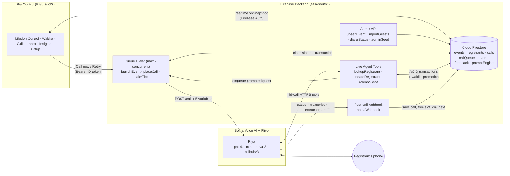
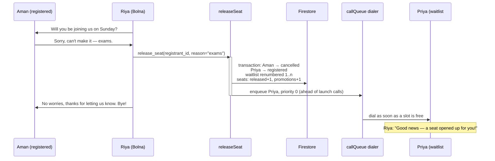

# Riya: Autonomous Voice Event-Ops Agent + Ria Control

[](https://riya-event-ops-485f.web.app)
[](https://bolna.ai)
[](./firebase)
[](./Ria%20Control)
[](./firebase/functions)
[](#testing)

**Built for Build Out Loud: A Wispr Flow × Bolna Hackathon** · [Event page](https://luma.com/1a2rjj9r)

Riya is a voice agent that phones every registrant of an event and does the work organisers normally do by hand:

- confirms who is actually coming;
- collects team name, team size, food preference and T-shirt size;
- answers questions about the event;
- refills the seat when someone cancels by promoting and calling the next person on the waitlist. No human is involved.

**Ria Control** is the live dashboard organisers use to watch all of this happen and to step in when needed.

This repository contains the whole system:

| Part | Folder | Stack |
| :--- | :--- | :--- |
| Voice agent prompts | [`firebase/prompt/`](./firebase/prompt) | Bolna · gpt-4.1-mini · Deepgram nova-2 STT · Sarvam bulbul:v3 Indian-English TTS · Plivo telephony |
| Backend | [`firebase/`](./firebase) | Firebase Cloud Functions 2nd gen · TypeScript · Node 22 · Cloud Firestore · Secret Manager · Cloud Scheduler |
| Organiser dashboard | [`Ria Control/`](./Ria%20Control) | Expo SDK 58 · Expo Router · React Native Web · TypeScript · Firebase Auth + Firestore realtime |

- **Live dashboard:** https://riya-event-ops-485f.web.app
- **Backend:** `https://asia-south1-riya-event-ops-485f.cloudfunctions.net` (Mumbai region)

---

## Table of contents

1. [The problem](#the-problem)
2. [What a call with Riya sounds like](#what-a-call-with-riya-sounds-like)
3. [Architecture](#architecture)
4. [The waitlist chain](#the-waitlist-chain-the-core-idea)
5. [The dialer](#the-dialer-2-call-concurrency-queue)
6. [Mid-call tools](#mid-call-tools)
7. [After the call: webhook & extraction](#after-the-call-webhook--extraction)
8. [Multi-event & Luma import](#multi-event--luma-import)
9. [Ria Control dashboard](#ria-control-dashboard)
10. [Data model](#data-model)
11. [Cloud Functions reference](#cloud-functions-reference)
12. [Security](#security)
13. [Testing](#testing)
14. [Running it yourself](#running-it-yourself)
15. [Repository layout](#repository-layout)
16. [Engineering notes & lessons](#engineering-notes--lessons)
17. [Roadmap](#roadmap)

---

## The problem

Before a hackathon, organisers have a registration list where many people never show up. They also have a waitlist of people who would come if a seat opened.

Every spot has to be confirmed by phone or WhatsApp, and every team, food and T-shirt detail has to be chased by hand. When someone drops out the day before, nobody has time to call the waitlist.

The result: empty seats, wrong food counts and a waitlist that never gets used.

**Riya turns that into a background process.** The organiser imports the guest list and presses *Launch*. Riya calls everyone, at most two at a time, records answers in the database while the caller is still talking, and keeps the event full on her own.

---

## What a call with Riya sounds like

Riya speaks natural Indian English. She can switch to Hinglish if the caller does, and sounds like a friendly college senior on the organising team, not a call centre.

```
Riya:   Hi Aman! This is Riya from the HACK2026 team. Can you hear me okay?
Aman:   Yeah, hi.
        └─ lookup_registrant → still_needed: [status, team_name, team_size, food_pref, tshirt_size]
Riya:   Will you be joining us at HACK2026 on Sunday, 13 December?
Aman:   Yes, I'll be there.
        └─ update_registrant(status = confirmed)
Riya:   Nice. What's your team called? If you're solo, just say solo.
Aman:   Byte Busters.                         └─ update_registrant(team_name)
Riya:   How many of you in the team? Max is four.
Aman:   Five actually.                        └─ update_registrant(team_size=5) → ok:false, limit 4
Riya:   Ah, teams can be four max — how many will it be?
Aman:   Okay, four.                           └─ update_registrant(team_size=4)
Riya:   Veg, non-veg or Jain?   …   And your T-shirt size? XS to XXL.
Riya:   So that's team Byte Busters, four of you, veg food and a medium T-shirt. All good?
Aman:   Make it large.                        └─ update_registrant(tshirt_size=L)
Riya:   Done. Any questions about the event?
Riya:   Awesome, you're all set! See you on Sunday. Bye!
```

**Call flow:**
1. Hearing check.
2. Attendance.
3. Team name and size (max 4).
4. Food preference.
5. T-shirt size.
6. One-sentence read-back of all the answers.
7. The caller's questions.
8. A warm one-line close.

**Behaviour rules** (from [`riya-system.md`](./firebase/prompt/riya-system.md)):
- One question per turn. Short answers like "veg" or "M" count as complete answers.
- She **never asks again for something already known**: `lookup_registrant` returns `still_needed`.
- Answers are saved **the moment they're clear**. If the caller changes one, even after the read-back, the new value is saved immediately.
- If an answer is unclear, she asks again instead of guessing. She uses only the event facts she was given and never invents prizes, timings or rules.
- **Busy?** She asks for a callback time and saves it. **Maybe?** She saves `maybe` and when they'll know. **No?** She asks gently for one reason, calls `release_seat` and ends the call kindly.
- She hangs up cleanly after the closing line, or as soon as the caller says bye. Bolna's hangup-by-prompt option is on, with a dedicated [hangup prompt](./firebase/prompt/riya-hangup.txt).

Every call is personalised with five variables built from the event and registrant records: `{name}`, `{registrant_id}`, `{event_name}`, `{event_date}` (spoken form, e.g. "Sunday, 13 December 2026") and `{venue}`.

---

## Architecture



The design rules behind it:
- **Firestore is the single source of truth.** The agent, dashboard and dialer all read and write the same documents, so the dashboard updates live without polling.
- **Every outbound call goes through one queue.** Nothing calls Bolna directly, not even the dashboard's *Call now* button. That's how the 2-call account limit, the calling window and promotion priority are always respected.
- **Business logic is pure and tested.** Validation, waitlist planning, call variables and dialer decisions live in [`logic.ts`](./firebase/functions/src/logic.ts) and [`queue.ts`](./firebase/functions/src/queue.ts) as side-effect-free functions. HTTP handlers only wrap them.

---

## The waitlist chain (the core idea)



- **One transaction.** The cancellation, the promotion, the waitlist renumbering and the seat counters all succeed together or not at all. Two people cancelling at the same moment can't both promote the same waitlisted person.
- **No overbooking on a change of heart.** If someone cancels and later says yes again after their seat was given away, they go back on the waitlist instead of taking a seat that no longer exists.
- **The chain continues.** If the promoted person also declines, their call triggers `release_seat` again and the next person is called.

---

## The dialer (2-call concurrency queue)

The Bolna account allows **2 simultaneous calls**. Event launches, waitlist promotions and dashboard *Call now* / *Retry* clicks all go through [`queue.ts`](./firebase/functions/src/queue.ts):

```
pending ──claim (transaction)──▶ dialing ──Bolna accepted──▶ active ──webhook: call ended──▶ done
   │                               │                            │
   │                               └──retryable 429/5xx──▶ pending (2-min backoff, max 3 attempts)
   │                               └──fatal error──────────▶ failed
   └──guest no longer eligible──▶ skipped                       └──no webhook in time──▶ timeout
```

- **Priority:** waitlist promotions, *Call now* and *Retry* are priority `0`. Launch calls are priority `10`, so a newly freed seat is always filled first.
- **Slot claiming in a transaction:** a slot is taken only if fewer than `MAX_CONCURRENT_CALLS` items are `dialing`/`active`. Two dialer runs at the same moment can never exceed the limit.
- **No two calls to the same number at once:** a queued call to a number that already has a call in flight waits until that call ends.
- **Calling window:** calls are placed only inside `CALL_START_HOUR`–`CALL_END_HOUR` in the recipient's time zone (default 10:00–20:00 IST, configurable). Outside the window, items wait.
- **Event switch:** guests of disabled events are never dialled. Disabling an event pauses its queue.
- **Self-healing:** `dialerTick` runs every minute. It times out calls with no final webhook after 15 minutes, recovers dials stuck for more than 3 minutes and fills free slots. Every webhook that ends a call also triggers the next dial immediately.

---

## Mid-call tools

Riya calls three authenticated HTTPS endpoints while she's talking (`Authorization: Bearer $TOOL_TOKEN`). Tool arguments are always English values, whatever language the caller is speaking.

| Tool | Input | What it does |
| :--- | :--- | :--- |
| `lookup_registrant` | `registrant_id` | Returns the known answers, event details and **`still_needed`**, the list of questions Riya may still ask, in order. |
| `update_registrant` | `registrant_id, field, value` | Validates and normalises one answer: `status` (confirmed/maybe/declined), `team_name`, `team_size` (1–event max), `food_pref` (veg/non-veg/jain), `tshirt_size` (XS–XXL), `callback_time`, `notes`. Invalid input returns `ok:false` with a message Riya says out loud in her own words. |
| `release_seat` | `registrant_id, reason` | Cancels the caller's seat and starts the [waitlist chain](#the-waitlist-chain-the-core-idea). |

`pre_call_message` is set to `""` on every tool. Without that, Bolna inserts a robotic "please wait" filler before each tool call.

---

## After the call: webhook & extraction

`bolnaWebhook` receives every status update and the final payload:

- Stores **status, termination reason, who hung up, duration, transcript, summary, recording URL, extracted data, status history and the raw payload** in `calls/{executionId}`.
- **Ignores out-of-order deliveries.** A late "ringing" event can't overwrite "completed".
- Links the call to the registrant by `registrant_id`, falling back to the phone number.
- **Fills in answers** from Bolna's post-call extraction ([`riya-extraction.txt`](./firebase/prompt/riya-extraction.txt)) as structured JSON: attendance, team, size, food, T-shirt, callback time, caller questions and feedback. Anything a tool call missed still reaches the registrant record.
- Writes caller questions and feedback to `feedback/{executionId}` for the organiser inbox.
- Marks the queue item `done` and dials the next queued call.

---

## Multi-event & Luma import

- **Events** live in `events/{id}`: name, date, time zone, speakable venue, full address, capacity, max team size and an `enabled` switch. New events start **disabled**, so nothing is dialled by accident.
- **Luma import:** `upsertEvent` takes a public Luma link and reads the page's `__NEXT_DATA__` / JSON-LD to get the title, start time, time zone and address. Riya's `event_name`, `event_date` and `venue` variables come straight from that.
- **Guest import:** `importGuests` takes the host's Luma CSV export (the `luma` preset), or any CSV with a custom column mapping (Google Forms, Devfolio, Eventbrite…). How rows are handled:
  - Approved guests become registered, and pending ones go to the waitlist.
  - Rows without a status fill capacity first, then the waitlist.
  - Phone numbers are normalised to E.164.
  - Guest IDs are deterministic (`EVENTID-<hash>`), so **re-importing is safe** and never resets answers Riya has already collected.
- **Dry runs everywhere:** import and launch both support `--dry-run`, which shows counts and sample call variables before anything is written or dialled.

---

## Ria Control dashboard

An Expo app ([`Ria Control/`](./Ria%20Control)) that runs on the web (deployed to Firebase Hosting) and in Expo Go on iOS. Organisers sign in with Firebase Auth. All data streams in live through Firestore `onSnapshot` listeners.

| Screen | What organisers see and do |
| :--- | :--- |
| **Mission Control** | Live confirmed-seat counter with animated digits and a capacity bar, connect rate, **2-slot dialer monitor** (Slot 1/2, Slot 2/2, calling window, queue items: Queued · Dialling · On line · Done · Failed), **live call card** with animated waveform, timer and streaming transcript, and a seat activity timeline (confirmations, cancellations, auto-promotions). |
| **Waitlist** | Ranked waitlist and full registrant roster with one-click **Call now** and **Promote**. |
| **Calls** | Call log with outcome filters. Each call has its full transcript, extracted fields, summary and a **Retry** button. |
| **Inbox** | Callback requests, escalations and de-duplicated caller questions, so organisers know what to put in the next email. |
| **Insights** | Food and T-shirt tallies (the ordering list for catering and merch), prompt-version ratings and a **one-click CSV headcount export**. |
| **Setup** | 4-step wizard: event type → auto-fill from a Luma link → import guests by CSV (Luma, Google Forms, Devfolio and Eventbrite columns are mapped automatically) → launch. |

*Call now* and *Retry* send a POST with the organiser's Firebase ID token to `placeCall`, which puts the call in the queue. The browser never touches the Bolna API key.

---

## Data model

| Collection | Document | Key fields |
| :--- | :--- | :--- |
| `events` | `{eventId}` | name, date, startAt, timezone, venue, fullAddress, capacity, maxTeamSize, enabled, source |
| `registrants` | `{id}` | eventId, name, phone (E.164), status, teamName, teamSize, foodPref, tshirtSize, notes[], waitlistRank, callbackTime, lastCall |
| `seats` | `{eventId}` | capacity, held, released, promotions |
| `calls` | `{executionId}` | status, terminationReason, hangupBy, durationSec, transcript, extractedData, summary, recordingUrl, statusHistory[], registrantId, trigger, rawJson |
| `callQueue` | `{id}` | registrantId, eventId, reason, priority, status, attempts, notBeforeMs, createdAtMs, startedAtMs, allowedStatuses |
| `feedback` | `{executionId}` | feedback, callerQuestions |
| `promptEngine` | `riya` | system prompt, welcome message, extraction prompt (mirrors [`firebase/prompt/`](./firebase/prompt)) |

Registrant statuses: `registered`, `confirmed`, `maybe`, `declined`, `waitlist`, `cancelled`.

---

## Cloud Functions reference

Base URL: `https://asia-south1-riya-event-ops-485f.cloudfunctions.net`

| Function | Trigger | Auth | Purpose |
| :--- | :--- | :--- | :--- |
| `lookupRegistrant` | HTTPS POST | `Bearer $TOOL_TOKEN` | Known fields, event details and `still_needed` |
| `updateRegistrant` | HTTPS POST | `Bearer $TOOL_TOKEN` | Validate and save one answer |
| `releaseSeat` | HTTPS POST | `Bearer $TOOL_TOKEN` | Cancel, promote waitlist #1, renumber, enqueue the promotion call |
| `bolnaWebhook` | HTTPS POST | `?token=` / `x-webhook-token` | Save call data, fill in answers, free the slot, dial next |
| `placeCall` | HTTPS POST | Firebase ID token or `$ADMIN_TOKEN` | Dashboard *Call now* / *Retry* → queue |
| `dialerTick` | Cloud Scheduler, every 1 min | — | Time out stale calls, recover interrupted dials, fill free slots |
| `upsertEvent` | HTTPS POST | `Bearer $ADMIN_TOKEN` | Create or update an event, by hand or from a Luma link |
| `importGuests` | HTTPS POST | `Bearer $ADMIN_TOKEN` | Import a CSV with capacity and waitlist assignment |
| `launchEvent` | HTTPS POST | `Bearer $ADMIN_TOKEN` | Queue calls to every eligible guest of an enabled event |
| `dialerStatus` | HTTPS POST | `Bearer $ADMIN_TOKEN` | Queue counts, items, registrants and recent calls |
| `adminSeed` | HTTPS POST | `Bearer $ADMIN_TOKEN` | Reset the demo event `HACK2026` |

---

## Security

- **Every endpoint needs a token** and returns 401 without one. Tokens are compared in constant time (`timingSafeEqual`).
- **Secrets live in Google Secret Manager** (`defineSecret`): `BOLNA_API_KEY`, `TOOL_TOKEN`, `WEBHOOK_TOKEN`, `ADMIN_TOKEN`. None are in the repo. Local copies (`.secrets.local`, `*.local`, `.env`) are git-ignored.
- **Firestore rules:** signed-in organisers can read data and edit events, registrants and seats. `callQueue` and `calls` can be written only by the backend (Admin SDK). Unauthenticated clients get nothing.
- **Separate tokens per caller type:** the agent's tools, Bolna's webhook and admins each use their own token, so one leak can't unlock the others.
- The Firebase *web* API key in the dashboard is a public identifier by design. Access is enforced by Auth and the security rules.

---

## Testing

```bash
cd firebase/functions
npm test               # 17 unit tests: validation, team-size limits, waitlist planning, spoken dates,
                       # call variables, E.164 normalisation, webhook mapping, Luma parsing,
                       # CSV import planning (capacity, ranks, dedupe), dialer helpers
npm run test:emulator  # Firestore emulator integration: real transactions for update / release /
                       # promotion / renumbering / webhook linking (needs Java 21)
```

On top of these, the deployed system was checked with live smoke tests of every endpoint, launch dry runs against the real hackathon Luma page, and live calls through Bolna.

---

## Running it yourself

**Prerequisites:**
- Node 22 and the Firebase CLI.
- A Firebase project on the Blaze plan.
- A Bolna account and agent.
- Java 21 (only for the emulator tests).

### Backend

```bash
cd firebase/functions
npm install

# secrets (one-time)
firebase functions:secrets:set BOLNA_API_KEY
firebase functions:secrets:set TOOL_TOKEN
firebase functions:secrets:set WEBHOOK_TOKEN
firebase functions:secrets:set ADMIN_TOKEN

# non-secret params: functions/.env.<project-id>
#   BOLNA_AGENT_ID=...  BOLNA_FROM_NUMBER=  MAX_CONCURRENT_CALLS=2  CALL_START_HOUR=10  CALL_END_HOUR=20

npm run deploy
```

**Configure the Bolna agent:**
1. Use the prompts in [`firebase/prompt/`](./firebase/prompt) (system, welcome, hangup, extraction).
2. Add three custom API tools pointing at `lookupRegistrant`, `updateRegistrant` and `releaseSeat`, with `Bearer $TOOL_TOKEN` and `pre_call_message: ""`.
3. Set the webhook URL to `bolnaWebhook?token=$WEBHOOK_TOKEN`.

### Run an event

```bash
npm run event  -- --luma https://luma.com/<event> --capacity 40      # creates event (disabled)
npm run import -- --event LUMA-<ID> --csv guests.csv --dry-run       # preview
npm run import -- --event LUMA-<ID> --csv guests.csv
npm run event  -- --id LUMA-<ID> --enable
npm run launch -- --event LUMA-<ID> --dry-run                        # check counts + sample variables
npm run launch -- --event LUMA-<ID>
npm run dialer -- --event LUMA-<ID>                                  # watch the queue
```

### Dashboard

```bash
cd "Ria Control"
npm install
cp .env.example .env      # Firebase web config
npm run web               # local dev
npm run typecheck
npm run deploy            # expo export -p web && firebase deploy --only hosting
```

---

## Repository layout

```text
.
├── README.md
├── firebase/                         # Backend
│   ├── firebase.json · firestore.rules · firestore.indexes.json
│   ├── prompt/                       # Riya: system, welcome, hangup and extraction prompts
│   └── functions/
│       ├── src/
│       │   ├── index.ts              # 11 HTTPS + scheduled functions
│       │   ├── logic.ts              # pure rules: validation, still_needed, release plan, spoken dates
│       │   ├── queue.ts              # transactional 2-slot dialer + callQueue state machine
│       │   ├── registrants.ts        # lookup / update / release (Firestore transactions)
│       │   ├── webhook.ts            # Bolna payload mapper, out-of-order guard, answer fill-in
│       │   ├── events.ts · luma.ts   # multi-event upsert, public Luma page parser
│       │   ├── importer.ts · csv.ts  # idempotent CSV guest import with presets and mappings
│       │   ├── bolna.ts              # Bolna REST client, E.164 normaliser
│       │   ├── http.ts · config.ts · db.ts · seed.ts
│       ├── scripts/                  # admin CLI: seed, event, import, launch, dialer
│       ├── seed/                     # demo event HACK2026 + registrants
│       └── test/                     # unit tests + emulator integration test
└── Ria Control/                      # Organiser dashboard (Expo)
    ├── src/app/                      # Expo Router: (tabs)/index, waitlist, calls, call/[id], inbox, insights; setup
    ├── src/components/               # UI kit, live waveform, call rows, seat activity timeline
    ├── src/data/                     # Firestore realtime store, auth, normalisers, selectors, mock feed
    └── src/lib/                      # CSV parser, Luma helper, formatters
```

---

## Engineering notes & lessons

- **Always pass all five call variables.** With any missing, the model guessed dates and passed the wrong `registrant_id` to tools. The dialer builds the variables from the event and registrant records every time.
- **Empty `pre_call_message`.** Leaving it out makes Bolna insert a filler phrase before every tool call. On a five-question call that sounds robotic fast.
- **A read-back instead of echoing every answer.** Repeating each answer made the first live call feel stiff. One summary sentence at the end is natural and still catches mistakes.
- **Tool values are always English,** even mid-Hinglish, so the backend's validation stays simple and strict.
- **Queue first, call second.** The first version called Bolna straight from `releaseSeat`, which could break the 2-call limit if two people cancelled at once. Routing every call through one transactional queue rules that out.
- **Bolna MCP gotcha:** the connector's `update_agent` silently ignores `tasks` (tools, LLM, transcriber). To change those, the agent has to be recreated.

---

## Roadmap

- Parse free-text `callback_time` and schedule the callback through the queue's `notBeforeMs`.
- A knowledge base for richer event Q&A (schedule, prizes, rules).
- WhatsApp follow-up after a call with the confirmed details.
- Restrict the webhook to Bolna's published IP addresses.

---

*Built at Build Out Loud: A Wispr Flow × Bolna Hackathon.*
