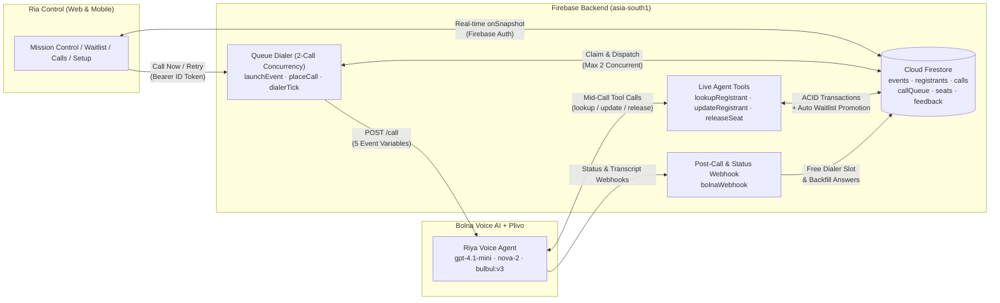

# Riya — Autonomous Voice Event-Ops Agent & Live Mission Control

**Built for Build Out Loud: A Wispr Flow × Bolna Hackathon**

Riya is an end-to-end autonomous voice operations system powered by **Bolna**, **Firebase Cloud Functions (2nd Gen)**, **Firestore**, and **Expo (React Native Web & iOS)**. Riya calls event registrants to confirm attendance, capture team and logistics preferences (team name, team size, dietary preference, T-shirt size), answer event questions, and **automatically promote and dial waitlisted guests in real time** the moment a confirmed attendee cancels.

- **Live Mission Control Dashboard**: [https://riya-event-ops-485f.web.app](https://riya-event-ops-485f.web.app)
- **Backend Region**: `asia-south1` (Mumbai) · Firebase Project `riya-event-ops-485f`
- **Voice Agent**: Bolna Agent `Riya` (`gpt-4.1-mini` + Deepgram `nova-2` STT + Sarvam `bulbul:v3` Indian English TTS + Plivo Telephony)

---

## Architecture Overview



---

## Key Capabilities

### 1. Real-Time Waitlist Chain & Seat Promotion (`releaseSeat`)
When a registered attendee tells Riya they cannot make it:
1. Riya invokes `release_seat` mid-call.
2. Inside a single Firestore ACID transaction, the backend marks the caller `cancelled`, promotes the `#1` waitlisted registrant (`waitlistRank: 1`) to `registered`, renumbers the remaining waitlist (`1..n`), and updates `seats/{eventId}` (`held`, `released`, `promotions`).
3. The promoted registrant is immediately enqueued into `callQueue` with **priority `0`** (jumping ahead of standard launch calls) and dialled automatically as soon as a concurrency slot is free.

### 2. Concurrency-Safe Outbound Dialer (`callQueue`)
Every outbound call—whether from an event launch, a waitlist promotion, or an organiser clicking **Call now** / **Retry** in Mission Control—routes through `callQueue`:
- **2-Call Concurrency Limit**: Enforces `MAX_CONCURRENT_CALLS = 2` via transactional slot claiming (`pending → dialing → active → done | failed | skipped | timeout`).
- **Same-Number Collision Guard**: Prevents dialling a second queued call to a phone number that currently has an active call in flight, and waits for a post-hangup buffer before dialling the next call on that line.
- **Calling Window Guardrails**: Only places calls within `10:00–20:00 IST`.
- **Self-Healing Recovery**: `dialerTick` runs every minute to recover interrupted dials or stale slots and keep the queue moving.

### 3. Live Mid-Call Tool Execution
During each call, Riya uses three authenticated HTTPS tools (`Authorization: Bearer $TOOL_TOKEN`):
- `lookup_registrant`: Retrieves what is already known about the caller and computes `still_needed` so Riya never re-asks answered questions.
- `update_registrant`: Normalises spoken answers (`veg`/`non-veg`/`jain`, `XS`–`XXL`, team size limits `1..4`, status transitions) and writes them to Firestore immediately as the caller speaks—including instant mid-call answer changes.
- `release_seat`: Releases the caller's seat, promotes waitlist `#1`, and enqueues their promotion call.

### 4. Multi-Event & Luma Integration
- **Luma Event Importer**: `upsertEvent` parses public Luma event pages (`__NEXT_DATA__` / JSON-LD) to extract event title, start timestamp, timezone, speakable venue, and full address.
- **CSV Guest Importer**: `importGuests` supports Luma exports and custom column mappings with deterministic guest IDs (`EVENTID-<hash>`) so re-imports are idempotent and never overwrite captured call answers.

### 5. Ria Control — Live Organiser Dashboard
Built with **Expo SDK 58 + Expo Router + TypeScript** ([`Ria Control/`](./Ria%20Control)):
- **Mission Control**: Live confirmed seat count, capacity bar, connect rate, active call waveform & live transcript ticker, **2-slot dialer queue monitor**, and seat activity feed.
- **Waitlist & Calls**: Full registrant table, waitlist queue with one-click **Call now** / **Promote**, call history with full transcripts, extracted data, and **Retry** via the backend dialer.
- **Inbox & Insights**: Callback requests, escalations, grouped caller questions from `extractedData`, dietary/T-shirt tallies, and one-click CSV headcount export.

---

## Repository Structure

```text
wisper-bolna/
├── firebase/                     # Firebase Backend (Cloud Functions v2 + Firestore)
│   ├── firestore.rules           # Organiser Auth read/write rules
│   ├── firestore.indexes.json    # Composite indexes for waitlist & callQueue
│   ├── prompt/                   # Riya prompt sources (mirrored to promptEngine/riya)
│   │   ├── riya-system.md        # System prompt (call flow, tool rules, tone)
│   │   ├── riya-welcome.txt      # Greeting message with variables
│   │   ├── riya-hangup.txt       # LLM hangup-detection prompt
│   │   └── riya-extraction.txt   # Post-call structured JSON extraction prompt
│   └── functions/                # Node 22 TypeScript Cloud Functions
│       ├── src/
│       │   ├── index.ts          # 11 HTTPS & Scheduled Cloud Functions
│       │   ├── queue.ts          # 2-slot transactional dialer & callQueue state machine
│       │   ├── registrants.ts    # lookupRegistrant, updateRegistrant, releaseSeat
│       │   ├── logic.ts          # Pure normalisation, waitlist promotion & seat rules
│       │   ├── webhook.ts        # bolnaWebhook payload mapper & answer backfiller
│       │   ├── events.ts         # Multi-event upsert & validation
│       │   ├── luma.ts           # Public Luma page parser
│       │   ├── importer.ts       # Idempotent CSV guest importer
│       │   └── bolna.ts          # Bolna REST API client & E.164 phone normaliser
│       ├── scripts/              # Admin CLI (seed, event, import, launch, dialer)
│       └── test/                 # 17 unit tests + Firestore emulator integration suite
└── Ria Control/                  # Expo Web & iOS Organiser Dashboard
    └── src/
        ├── app/                  # Expo Router screens (Mission Control, Waitlist, Calls, Inbox, Insights, Setup)
        ├── components/           # Editorial UI kit, live waveform, seat activity timeline
        ├── data/                 # Live Firestore real-time store, normalisers & selectors
        └── lib/                  # CSV parser, Luma helper, formatters
```

---

## Cloud Functions Reference

Base URL: `https://asia-south1-riya-event-ops-485f.cloudfunctions.net`

| Function | Trigger | Auth | Purpose |
| :--- | :--- | :--- | :--- |
| `lookupRegistrant` | HTTPS `POST` | `Bearer $TOOL_TOKEN` | Returns known registrant fields, event details, and `still_needed` list |
| `updateRegistrant` | HTTPS `POST` | `Bearer $TOOL_TOKEN` | Validates and saves a single registrant field (`status`, `team_name`, `team_size`, `food_pref`, `tshirt_size`, `callback_time`, `notes`) |
| `releaseSeat` | HTTPS `POST` | `Bearer $TOOL_TOKEN` | Cancels seat, promotes waitlist `#1`, renumbers waitlist, and enqueues promotion call |
| `bolnaWebhook` | HTTPS `POST` | `?token=$WEBHOOK_TOKEN` | Saves call transcript, duration, and extracted data; frees dialer slot and dispatches next queued call |
| `placeCall` | HTTPS `POST` | Firebase Auth ID Token / `$ADMIN_TOKEN` | Enqueues a `call_now` or `retry` request from Ria Control into `callQueue` and dispatches |
| `dialerTick` | Scheduler (1 min) | Cloud Scheduler | Sweeps timed-out/interrupted calls and dispatches pending queue items |
| `upsertEvent` | HTTPS `POST` | `Bearer $ADMIN_TOKEN` | Creates or updates an event manually or from a public Luma URL |
| `importGuests` | HTTPS `POST` | `Bearer $ADMIN_TOKEN` | Imports guests from Luma/custom CSV with capacity & waitlist assignment |
| `launchEvent` | HTTPS `POST` | `Bearer $ADMIN_TOKEN` | Enqueues outbound calls for all eligible registrants of an enabled event |
| `dialerStatus` | HTTPS `POST` | `Bearer $ADMIN_TOKEN` | Returns live queue counts, queue items, registrants, and recent calls |
| `adminSeed` | HTTPS `POST` | `Bearer $ADMIN_TOKEN` | Resets demo event (`HACK2026`), registrants, seats, and `promptEngine/riya` |

---

## Quick Start & CLI Usage

### 1. Backend (`firebase/functions`)

```bash
cd firebase/functions
npm install

# Run unit tests (17 tests)
npm test

# Run Firestore transaction integration tests against the local emulator
npm run test:emulator

# Seed demo event (HACK2026) and promptEngine
npm run seed

# Import a real event from Luma + import guest CSV
npm run event  -- --luma https://luma.com/1a2rjj9r --capacity 20 --enable
npm run import -- --event LUMA-1A2RJJ9R --csv seed/teammates.csv.local

# Launch calls through the 2-slot dialer queue and inspect status
npm run launch -- --event HACK2026 --force
npm run dialer -- --event HACK2026

# Deploy Cloud Functions & Firestore rules
npm run deploy
```

### 2. Organiser Dashboard (`Ria Control`)

```bash
cd "Ria Control"
npm install

# Typecheck
npm run typecheck

# Start local web dev server
npm run web

# Build static web bundle & deploy to Firebase Hosting
npm run deploy
```

---

## Security & Secrets

- All secrets (`BOLNA_API_KEY`, `TOOL_TOKEN`, `WEBHOOK_TOKEN`, `ADMIN_TOKEN`) are stored in **Google Cloud Secret Manager** via `defineSecret` and compared using constant-time `timingSafeEqual`.
- Local token overrides (`firebase/.secrets.local`) and local phone seed files (`*.local.json`, `*.local`) are strictly git-ignored.
- Firestore Security Rules (`firebase/firestore.rules`) require Firebase Authentication (`request.auth != null`) for organiser reads/updates and restrict `callQueue` mutations exclusively to the backend Admin SDK.

